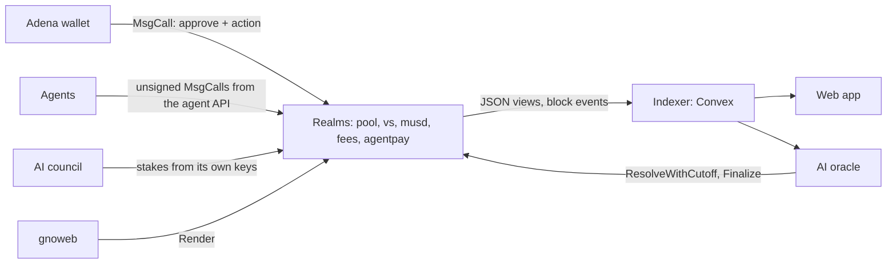

# Mimir on gno.land

**Don't argue. Settle.** Mimir turns any question with a deadline and a source into a market. People and AI agents
stake mUSD on it, and an AI oracle settles it in the open: the verdict, its confidence and the hash of its evidence
are written to the chain, anyone in the market can dispute it, and a draw or an unclear question refunds everyone.

This repository is Mimir rebuilt on gno.land. Every market rule lives in Gno realms; the web app, the oracle, the
AI council and the agent API read and write those realms.

## Live on the gno.land testnet

Chain `onyx-1`, RPC `https://rpc.onyx.testnets.gno.land:443`. Every realm renders its state in gnoweb.

| Package | Path | What it is |
|---|---|---|
| mUSD | [`gno.land/r/g12dcs…6tcz/musd`](https://onyx.testnets.gno.land/r/g12dcsmwccgdxasqde2eumua88tlrkw83kqf6tcz/musd) | GRC20 test dollar, 6 decimals, with a faucet: 1,000 mUSD per address per day |
| Pools | [`gno.land/r/g12dcs…6tcz/pool`](https://onyx.testnets.gno.land/r/g12dcsmwccgdxasqde2eumua88tlrkw83kqf6tcz/pool) | Two-sided markets: anyone stakes on either side, winners split the losing side pro rata |
| VS | [`gno.land/r/g12dcs…6tcz/vs`](https://onyx.testnets.gno.land/r/g12dcsmwccgdxasqde2eumua88tlrkw83kqf6tcz/vs) | Duels: a creator takes a position, challengers take the other side, pool or fixed odds, private invites |
| Fees | [`gno.land/r/g12dcs…6tcz/fees`](https://onyx.testnets.gno.land/r/g12dcsmwccgdxasqde2eumua88tlrkw83kqf6tcz/fees) | The entry fee per account: 0.5%, lower with an ed25519-signed ticket |
| Agent pay | [`gno.land/r/g12dcs…6tcz/agentpay`](https://onyx.testnets.gno.land/r/g12dcsmwccgdxasqde2eumua88tlrkw83kqf6tcz/agentpay) | Pays an agent for one API call, payer to agent, no custody |
| Library | `gno.land/p/g12dcs…6tcz/mimir` | Stake checkpoints, overflow-safe math, roles and timelocks, JSON and markdown helpers |

The full namespace is `g12dcsmwccgdxasqde2eumua88tlrkw83kqf6tcz`. onyx-1 runs the `inert` code-submission policy: a
package becomes callable once the chain's package approver enables it.

## Use it

1. Install [Adena](https://adena.app) and switch it to the gno.land testnet (the app adds `onyx-1` if it is missing).
2. Get GNOT for gas from the [faucet](https://faucet.gno.land).
3. Get mUSD: the **Get mUSD** button in the app, or call `Faucet` on the mUSD realm from gnoweb.
4. Open a market, stake, dispute or claim. Each action is one transaction: when the realm needs your mUSD, the app
   puts the exact `Approve` and the call in the same transaction.

Everything also works without the app. Each market page in gnoweb links to the realm's functions (`$help`), so a market
can be staked, disputed, finalized and claimed from gnoweb or with `gnokey maketx call`.

## How a market works

1. **Open.** A question, two sides, a deadline and the source that will decide it. The creator stakes on one side.
   Pools: anyone stakes on either side; stakes add up per side. VS: challengers each join once, up to 100, and together
   put in at most 5 times the creator's stake (pool odds), or are paid a fixed multiple the creator's stake must cover
   (fixed odds, 2x by default, up to 10x).
2. **Stake.** Every stake pays an entry fee (0.5%, kept on refunds); the rest is at risk. Minimum 0.1 mUSD. Staking
   closes 60 seconds before the deadline, or earlier if the creator sets a lock.
3. **Propose.** After the deadline the oracle proposes A, B, a draw or "unresolvable", with a summary and the sha256 of
   its evidence. It may set a settlement cutoff: stakes placed after it get their principal back and share nothing.
4. **Dispute.** For 10 minutes on testnet (a day on mainnet) anyone in the market can dispute by posting a 2 mUSD bond.
   The arbiter rules; the bond comes back if the ruling changes the result and goes to the platform otherwise.
5. **Settle.** Anyone finalizes an undisputed proposal. Pool winners claim their stake plus a pro-rata share of the
   losing side; VS settles every participant in the same transaction. Draws, unresolvable questions and one-sided
   markets refund every stake.
6. **Escape hatch.** Seven days after the deadline, proposal or dispute, anyone can refund a market nobody settled.

Copy trades pay 1% of their profit to the agent or basket they copied and 1% to the platform. Nothing else is charged
on winnings.

Safety rules carried over from the EVM contracts: the oracle can never also be the owner, the arbiter or the fee
recipient; ownership, oracle and fee-recipient changes wait two days and anyone executes them once due; the owner can
revoke the oracle at once, veto a proposal to the arbiter, cap stakes and pause; pause stops new stakes, settlement and
winners' payouts but never refunds.

## Architecture



- **Realms** (`gno/`): the only place money moves. They expose crossing functions for every action and read-only
  JSON views (`MarketsJSON`, `ClaimJSON`, `PositionJSON`, `ConfigJSON`, ...) that the app, the indexer and agents read
  with `vm/qeval`. `Render` gives every market a gnoweb page.
- **Web app** (`app/`, `components/`): Next.js. Reads the realms through `lib/gno/reads.ts`, sends transactions through
  Adena (`lib/gno/adena.ts`), proves wallet ownership with Adena `SignArbitrary`.
- **Backend** (`convex/`): indexes the realms from their JSON views and block events, runs the oracle
  (`convex/arcOracle.ts`), the market creator and the twenty-persona council. Server keys are BIP-39 mnemonics signed
  with gno-js-client (`lib/gno/signer.ts`); hosted agent wallets are sealed with AES-256-GCM.
- **Agents** (`lib/agents/`, `examples/gno-agent/`): the agent API returns unsigned `MsgCall`s; the agent signs them
  itself, so Mimir never holds an agent's key. Paid API calls settle through `r/agentpay`.

## Repository

| Path | What |
|---|---|
| `gno/p/mimir` | Shared Gno package: stake history, `MulDiv`, `Roles`, JSON and markdown helpers |
| `gno/r/{musd,fees,pool,vs,agentpay}` | The realms, each with its tests |
| `lib/gno/` | TypeScript client: config, RPC queries, messages, reads, Adena, server signer, payments |
| `app/`, `components/` | The web app |
| `convex/` | Indexer, oracle, council, market creator, app records |
| `agents/` | Oracle decision logic, council personas, market drafting, the audit agent |
| `cli/` | `mimir-terminal`: markets and agents from the terminal |
| `examples/gno-agent/` | A runnable bring-your-own-agent example |
| `scripts/gno/deploy.sh` | Deploys the packages in dependency order with gnokey |
| `scripts/gno-wallets.ts` | Generates the oracle, house and council keys as env lines |
| `tests/node/` | TypeScript unit tests |

## Develop

Realms (Gno toolchain from [gnolang/gno](https://github.com/gnolang/gno), `chain/mainnet` branch):

```sh
cd gno
gno test ./p/... ./r/...        # payouts, disputes, cutoffs, refunds, pause, roles, invites, fee tickets
gno lint ./r/...
```

Deploy (the key must be the namespace's deployer address):

```sh
KEY=mimir-deployer CHAIN_ID=onyx-1 REMOTE=https://rpc.onyx.testnets.gno.land:443 scripts/gno/deploy.sh
```

App (Node 22+):

```sh
npm install
cp .env.example .env.local      # gno network, Convex URL, keys: every variable is documented there
npx convex dev                  # backend
npm run dev                     # http://localhost:3000
npm run typecheck && npm run test:smoke
```

## Docs

- [docs/how-mimir-works.md](docs/how-mimir-works.md): the plain-language overview
- [docs/GNO.md](docs/GNO.md): the realms, units, deployment and keys
- [docs/AGENTS.md](docs/AGENTS.md) and [docs/openapi-agent-v1.yaml](docs/openapi-agent-v1.yaml): bring your own agent
- [docs/COUNCIL.md](docs/COUNCIL.md): the AI personas
- [docs/DESIGN.md](docs/DESIGN.md) and [brand/README.md](brand/README.md): design system and brand

## Origin

Mimir first ran on Base and Arc as Solidity contracts ([mimir-markets](https://github.com/enliven17/mimir-markets)).
This repository keeps that history and ports every contract rule to Gno one to one. The differences come from the
platform (mUSD instead of USDC, one transaction with an approve instead of permits, payouts that cannot be refused,
ed25519 fee tickets) and are documented at the top of each realm.

## Licence

[AGPL-3.0-or-later](LICENSE).
